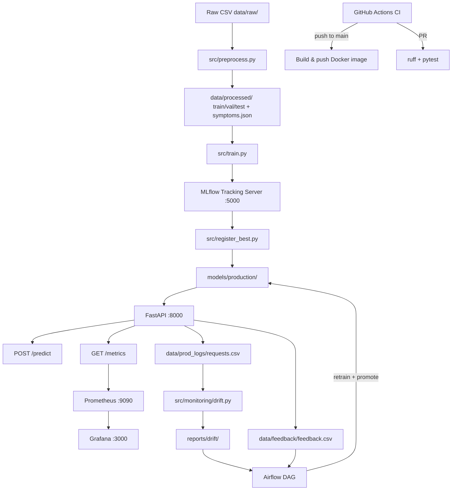

# Disease Prediction — Symptom-to-Disease-to-Specialist Recommender

> **Academic MLOps project** — Not for clinical use.
> *"Suggestion tool, not a medical diagnosis."*

A full-lifecycle MLOps system built for the *MLOps and AI Development* college course.
Given a set of binary symptom inputs the system predicts the **top-3 most likely diseases**
with confidence scores, maps each to the appropriate **medical specialist**, raises an
**emergency flag** when red-flag rules fire, and serves everything through a production-grade API.

---

## Architecture



---

## End-to-End Pipeline

```
Raw Data → Preprocess → Train (3 models) → MLflow Tracking → Quality Gate
         → Register Production Model → FastAPI Service → Prometheus/Grafana
         → Evidently Drift Detection → Airflow DAG (auto-retrain + promote)
                                     ↑ feedback loop from /feedback endpoint
```

---

## Repository Structure

```
.
├── .github/
│   ├── workflows/
│   │   ├── ci.yml                # PR checks: ruff + pytest + docker build
│   │   └── cd.yml                # Push-to-main: build & push to GHCR
│   └── pull_request_template.md
├── config/
│   ├── drift_config.yaml         # Evidently drift thresholds & sample size
│   ├── emergency_rules.json      # Rule-based emergency red-flag definitions
│   └── model_config.yaml         # Training hyperparameters & quality gates
├── dags/
│   └── retrain_symptom_model.py  # Airflow DAG: check → retrain → promote
├── data/
│   ├── raw/                      # Original CSVs (never modified)
│   ├── processed/                # train.csv, val.csv, test.csv, symptoms.json
│   ├── feedback/                 # Clinician feedback logs
│   ├── prod_logs/                # Per-request production logs (for drift)
│   └── retraining/               # Timestamped retraining datasets
├── docs/                         # Architecture, workflow, demo, viva notes
├── models/
│   ├── production/               # Active serving model artefacts + metadata
│   └── candidate_temp/           # Candidate model during comparison
├── monitoring/
│   ├── prometheus/prometheus.yml # Scrape config
│   └── grafana/                  # Provisioned datasource + dashboard JSON
├── reports/drift/                # Evidently HTML reports + JSON summaries
├── scripts/
│   ├── generate_traffic.py       # Send N realistic /predict requests
│   ├── simulate_drift.py         # Normal / shifted traffic simulation
│   ├── start.ps1                 # One-command stack startup
│   └── stop.ps1                  # One-command stack teardown
├── src/
│   ├── api/
│   │   ├── main.py               # FastAPI app + middleware
│   │   ├── metrics.py            # Prometheus metric definitions
│   │   ├── model_loader.py       # ModelManager (load + predict_top3)
│   │   ├── emergency.py          # Rule-based emergency triage evaluator
│   │   └── schemas.py            # Pydantic request/response schemas
│   ├── monitoring/
│   │   └── drift.py              # Evidently drift detection + JSON summary
│   ├── data_audit.py             # EDA report generator
│   ├── preprocess.py             # Feature engineering + train/val/test split
│   ├── train.py                  # Multi-model training + MLflow logging
│   ├── register_best.py          # Quality gate + production registration
│   └── retrain_pipeline.py       # Retraining pipeline functions for DAG
├── tests/
│   ├── test_api.py               # FastAPI endpoint tests (42 total)
│   ├── test_data.py              # Data integrity and schema tests
│   ├── test_drift.py             # Drift detection unit tests
│   ├── test_model.py             # Model quality gate + inference tests
│   └── test_retrain.py           # Retraining pipeline + DAG import tests
├── .dockerignore
├── .env.example                  # Template — copy to .env before running
├── docker-compose.yml            # api + mlflow + prometheus + grafana
├── Dockerfile                    # Multi-stage API container
├── pyproject.toml                # ruff, pytest config
└── requirements.txt              # Pinned production dependencies
```

---

## Quick Start (From Scratch)

### Prerequisites

| Tool | Minimum version | Purpose |
|------|----------------|---------|
| Python | 3.10+ | All local scripts and tests |
| Git | 2.40+ | Version control |
| Docker Desktop | 4.28+ | Container stack |
| Docker Compose | v2.24+ | Multi-service orchestration |

### 1 · Clone and set up environment

```powershell
git clone <repo-url>
cd "Disease Prediction Using Machine Learning"

python -m venv venv
.\venv\Scripts\Activate.ps1

pip install -r requirements.txt
pip install -r requirements-dev.txt   # ruff, pytest-cov
```

### 2 · Configure environment variables

```powershell
Copy-Item .env.example .env
# Edit .env — set GRAFANA_ADMIN_PASSWORD and ADMIN_API_KEY at minimum
notepad .env
```

### 3 · Run the training pipeline (generates model artefacts)

```powershell
# Preprocess raw data
python src/preprocess.py

# Train all models and log to MLflow
python src/train.py

# Register best model and copy to models/production/
python src/register_best.py
```

> **Note:** The repo already ships `models/production/` and `data/processed/`
> so this step can be skipped if you just want to run tests and the API.

### 4 · Run the test suite

```powershell
.\venv\Scripts\pytest tests\ -q
# Expected: 43 passed
```

### 5 · Start the full Docker stack

```powershell
.\scripts\start.ps1
# Or manually:
docker compose up --build -d
docker compose ps        # all services should show (healthy)
```

### 6 · Verify the API

```powershell
# Health check
curl http://localhost:8000/health

# Predict
curl -X POST http://localhost:8000/predict `
  -H "Content-Type: application/json" `
  -d '{"symptoms": ["chest_pain", "breathlessness", "sweating"]}'

# Prometheus metrics
curl http://localhost:8000/metrics

# MLflow UI  → http://localhost:5000
# Grafana    → http://localhost:3000  (admin / <GRAFANA_ADMIN_PASSWORD>)
# Prometheus → http://localhost:9090
```

### 7 · Stop the stack

```powershell
.\scripts\stop.ps1
# Or: docker compose down
```

---

## API Reference

### `GET /health`
```json
{"status": "healthy", "model_loaded": true, "model_version": "1", "timestamp": "..."}
```

### `GET /symptoms`
Returns the ordered list of all 131 valid symptom names.

### `GET /model-info`
Returns model metadata: type, version, quality gate status, load time.

### `GET /metrics`
Prometheus text-format metrics (scraped automatically by Prometheus).

### `POST /predict`

**Request:**
```json
{
  "symptoms": ["chest_pain", "breathlessness", "sweating", "vomiting"]
}
```

**Response:**
```json
{
  "request_id": "abc123",
  "model_version": "1",
  "predictions": [
    {
      "disease": "Heart attack",
      "confidence": 0.87,
      "specialist": "Cardiologist"
    },
    {
      "disease": "Bronchial Asthma",
      "confidence": 0.07,
      "specialist": "Pulmonologist"
    },
    {
      "disease": "Pneumonia",
      "confidence": 0.04,
      "specialist": "Pulmonologist"
    }
  ],
  "emergency_flag": true,
  "emergency_reasons": ["Potential cardiac event detected"],
  "disclaimer": "Suggestion tool, not a medical diagnosis."
}
```

### `POST /feedback`
```json
{"request_id": "abc123", "helpful": false, "true_disease": "Pneumonia"}
```

### `POST /admin/reload-model`
Requires header `X-API-Key: <ADMIN_API_KEY>`.

---

## Running Tests

```powershell
# Full suite
.\venv\Scripts\pytest tests\ -v

# Single module
.\venv\Scripts\pytest tests\test_api.py -v

# With coverage
.\venv\Scripts\pytest tests\ --cov=src --cov-report=term-missing

# Lint
.\venv\Scripts\ruff check src tests dags scripts
```

---

## Service Ports

| Service | Port | URL |
|---------|------|-----|
| **Frontend UI** | **8080** | **http://localhost:8080** |
| FastAPI | 8000 | http://localhost:8000 |
| FastAPI docs (Swagger) | 8000 | http://localhost:8000/docs |
| MLflow | 5000 | http://localhost:5000 |
| Prometheus | 9090 | http://localhost:9090 |
| Grafana | 3000 | http://localhost:3000 |

---

## Frontend

A single-page vanilla HTML/CSS/JS UI served by an nginx container that also proxies
all `/api/*` requests to the FastAPI backend — no CORS config needed.

### Quick start

```powershell
# Start the full stack (includes the frontend service)
docker compose up -d --build

# Open in browser
Start-Process "http://localhost:8080"

# Verify the proxy works
Invoke-RestMethod http://localhost:8080/api/health

# Run a prediction through the proxy
$body = '{"symptoms": ["chest_pain", "breathlessness", "sweating"]}'
Invoke-RestMethod -Method Post -Uri http://localhost:8080/api/predict `
  -ContentType 'application/json' -Body $body | ConvertTo-Json -Depth 10
```

### Flow
```
Browser → nginx:8080 → (strip /api prefix) → FastAPI:8000 → model
```
See [`docs/phase-11-notes.md`](docs/phase-11-notes.md) for the full architecture.

### Screenshots

> _Placeholder — replace with actual screenshots for the presentation._

| Screen | What to show |
|--------|--------------|
| Symptom selection | Chips loaded, a few selected, tags visible |
| Search filter | Search box filtering chip list |
| Normal result | 3 cards with confidence bars + specialist |
| Emergency result | Red banner + reasons (`chest_pain`, `breathlessness`, `sweating`) |
| Feedback submitted | Thank-you message |
| API offline error | Friendly error message, no blank page |

## Troubleshooting

| Symptom | Fix |
|---------|-----|
| `ModuleNotFoundError: src` | Run from repo root; ensure venv is active |
| `models/production/ not found` | Run `python src/register_best.py` first |
| API returns 422 "Unknown symptom" | Use `GET /symptoms` to see valid names |
| Docker: port already in use | Change ports in `.env` (`API_PORT`, `FRONTEND_PORT`, etc.) |
| Frontend shows "Cannot reach the API" | Ensure `disease-api` container is healthy: `docker compose ps` |
| Grafana shows "No data" | Wait ~30 s after `docker compose up`; send traffic with `generate_traffic.py` |
| Prometheus "target down" | Ensure API container is healthy: `docker compose ps` |
| Airflow DAG not visible | Mount `dags/` correctly; see `docs/architecture.md` |
| ruff lint errors | Run `.\venv\Scripts\ruff check --fix src tests dags` |
| pytest ImportError on Airflow | Expected on Windows — Airflow mocks are included in the DAG |

---

## Phases Completed

| # | Phase | Branch |
|---|-------|--------|
| 1 | Project setup & data audit | `feature/phase-1-setup` |
| 2 | Preprocessing pipeline + data tests | `feature/phase-2-preprocessing` |
| 3 | Training + MLflow tracking + quality gate | `feature/phase-3-mlflow` |
| 4 | FastAPI service + emergency triage + feedback | `feature/phase-4-api` |
| 5 | Docker + docker-compose | `feature/phase-5-docker` |
| 6 | GitHub Actions CI/CD | `feature/phase-6-cicd` |
| 7 | Prometheus metrics + Grafana dashboards | `feature/phase-7-monitoring` |
| 8 | Evidently drift detection + simulation | `feature/phase-8-drift` |
| 9 | Airflow DAG — auto-retrain + model promotion | `feature/phase-9-airflow` |
| 10 | Documentation + demo readiness | `feature/phase-10-docs` |
| 11 | Frontend web interface (nginx + vanilla JS) | `feature/phase-11-frontend` |

---

## References

See [`docs/references.md`](docs/references.md).

## Disclaimer

This system is a **student academic project**. It uses a synthetic/simplified dataset
and should **never** be used for real clinical decisions. The emergency rules and
specialist mappings are illustrative and require clinical review.
